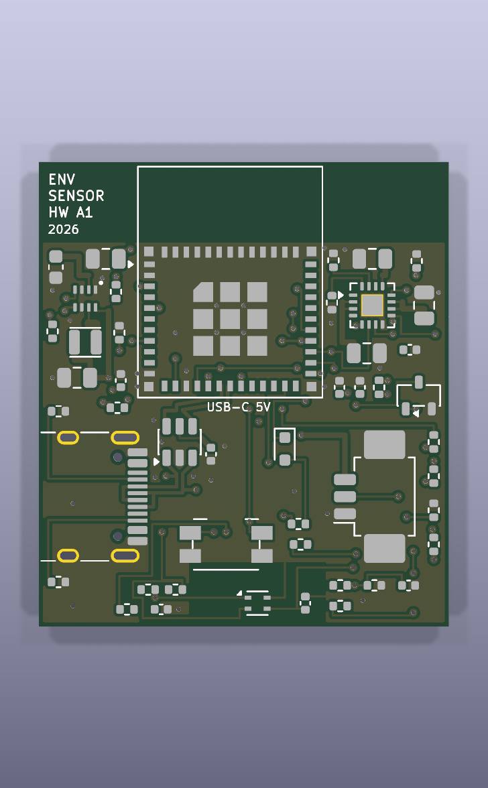
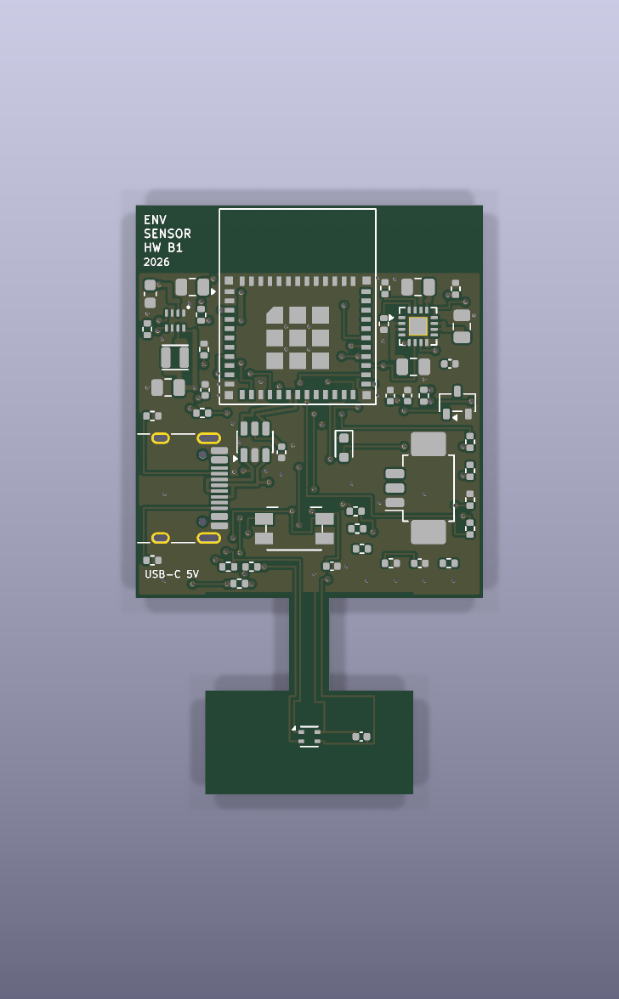
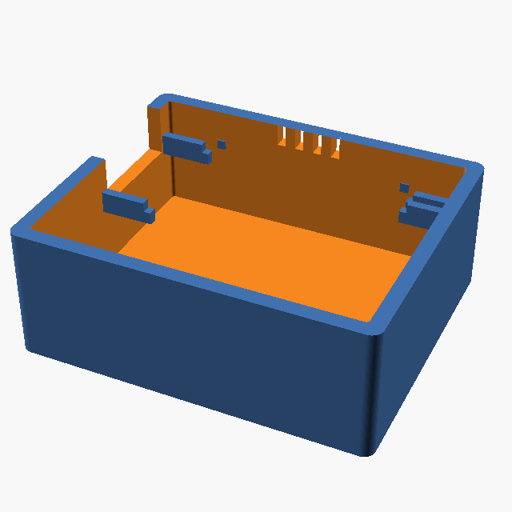
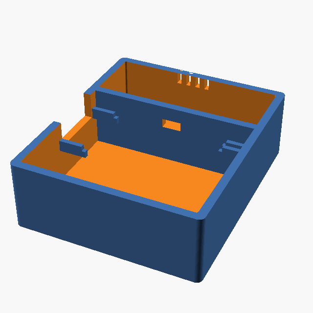

<div align="center">

# sensorly-unhinged

### A tiny sensor. Two very different ways to build it.

**My very first PCB project — an open hardware experiment in measuring the cost of compactness.**

[](https://github.com/marcelpetrick/sensorly-unhinged/actions/workflows/hardware.yml)
[](#status)
[](LICENSE)
[](https://www.kicad.org/)

[Explore the two designs](#meet-the-contenders) · [See what is verified](#status) · [Build it yourself](#build) · [Follow the plan](plan.md)

</div>

A battery-powered indoor temperature and humidity node sounds simple. Put the
sensor next to a radio, charger and battery, though, and the board can become
part of what it measures.

This project asks a practical question: **is a larger, thermally isolated design
worth its extra space, cost and mechanical complexity?** Instead of choosing by
intuition, it develops one electrical platform in two physical forms, with a
predeclared experiment to decide between them.

**Author:** [Marcel Petrick](mailto:mail@marcelpetrick.it) · **License:** [GPL-3.0-or-later](LICENSE)

**AI disclosure:** this project is generated with AI. Its design claims still need
traceable sources, review and physical verification.

## Meet the contenders

| **A — Compact · HW A1** | **B — Thermally isolated · HW B1** |
|:---:|:---:|
|  |  |
| **30 × 34 mm** PCB | **30 × 51 mm** PCB envelope |
| One rectangle; sensor at the edge | Sensor island on a **3.5 × 8 mm** FR-4 neck |
|  |  |
| **47.0 × 39.2 × 19.6 mm** enclosure | **47.0 × 56.2 × 19.6 mm** enclosure |
| One chamber | Two chambers, divided at the neck |

*These are generated previews, not photographs. Board renders omit component
bodies; enclosure fit and thermal benefit remain unmeasured.* Dimensions come
from the [floorplan](docs/40-floorplans.md) and
[enclosure model](docs/80-enclosure.md).

Both variants share the **ESP32-C6-MINI-1**, **SHT45-AD1F**, **BQ24074** charger,
**TPS62840** regulator, schematic, BOM and firmware. A protected 1S LiPo and
USB-C provide the power interfaces. Only geometry, thermal isolation and the
enclosure change.

The experiment is **5 A + 5 B**, compared with a reference instrument. The
[thermal test plan](docs/50-thermal-ab-test-plan.md) declares the decision gate
before the boards exist — including the conditions under which the simpler
compact design wins. B has to earn its extra space.

## What makes this worth following

- **The comparison stays fair.** One shared electrical model emits both boards;
  changes to values, nets and rules are considered together.
- **The case is part of the instrument.** Vents, chamber walls, battery placement
  and sensor supports belong in the thermal design.
- **Measure first, transmit later.** The firmware contract requires acquisition
  before the radio powers up; the current bring-up image keeps the radio off.
- **The work is inspectable.** Parametric KiCad generation, OpenSCAD models,
  datasheet references, fault-injection tests and release gates live alongside
  the design. Failed experiments remain in the execution history.

## Status

> **Engineering prototype — not ready for fabrication or use.**
> Source checks pass; complete routing, supplier reviews and real-hardware
> qualification are still required.

The current routing checkpoint (2026-11-13) is recorded in [the plan](plan.md):

| Check | Current evidence |
|---|---|
| Shared electrical design | One schematic, BOM and firmware for A and B |
| ERC / DRC / schematic parity | **0 violations, 0 errors, 0 warnings, 0 parity differences** |
| Routing | **A: 18 / B: 12 open connections**; zero GND/USB-data airwires |
| Reproducibility | Generated sources regenerate byte-identically |
| Local verification | Local checkpoint `9d3ba3a`: **15 stages**, 166 host tests and 41 actual KiCad controls pass; A18/B12 opens remain |
| Bring-up firmware | Pinned ESP-IDF build; radio disabled; acquired samples written to a reviewed flash journal |
| Physical qualification | Still open; no measured A/B advantage or qualified charging claim |

Exact routing counts live in [`hardware/drc-budget.json`](hardware/drc-budget.json).
The [execution record](docs/01-execution-plan.md) retains source revisions and
verification history. BLE provisioning, MQTT/TLS delivery, signed OTA and the
remaining product behavior are tracked in the
[firmware contract](docs/71-firmware-contract.md).

**Next:** finish routing → complete independent design and supplier reviews →
produce and inspect the controlled 5 + 5 lot → run the A/B experiment → revise
and qualify a controlled 20-unit series. The [flight manual](docs/02-flight-manual.md)
provides the procedures and stop conditions.

[](https://github.com/marcelpetrick/sensorly-unhinged/actions/workflows/release.yml)
[](https://github.com/marcelpetrick/sensorly-unhinged/releases)

The [first engineering source prerelease](https://github.com/marcelpetrick/sensorly-unhinged/releases/tag/engineering-2026-10-22)
is available to explore. It is a source snapshot, not a manufacturing release.
The quality badge tracks `master`; the repository-owned release labels describe
that separate release state without an empty workflow or nonexistent-latest-release badge.

## Follow the circuit

[](docs/img/schematic.svg)

One schematic feeds both layouts. Start with the
[electrical design specification](docs/30-electrical-design-spec.md) for values,
sources and open decisions, or open the
[KiCad source](hardware/schematic/env-sensor.kicad_sch).

## Build

Everything runs from `make`. The full local gate prints a PASS/FAIL summary:

```bash
./localPipeline.sh
```

For a first look without KiCad:

```bash
make check          # shared-model rules
make test           # host regression and fault-injection tests
make firmware-test  # C sensor-decoder and flash-journal tests
```

Python-only checks include `check`, `test`, `bom`, `thermal`, `cost` and `power`.
Firmware host tests require a C compiler and standard C development headers
(`gcc` and `libc6-dev` on the Debian CI image). ERC/DRC and exports require
**KiCad 10** (`kicad-cli`); enclosure meshes require **OpenSCAD**. The real
firmware build uses pinned **ESP-IDF v5.5.4** — follow the
[bring-up instructions](docs/72-firmware-bringup.md).

<details>
<summary><strong>Build commands and release gates</strong></summary>

```bash
make license        # SPDX headers on authored source
make gen            # shared schematic, both boards, rules and model SVGs
make erc drc        # shared schematic + filled-board checks and parity
make bom            # BOM and netlist from the shared model
make thermal cost   # geometry-based screening model and cost estimate
make mech           # enclosure checks, parameters and available STL outputs
make outputs        # DRAFT Gerbers, drill, CPL, assembly PDF and STEP
make render         # board PNG previews
make mech-render    # enclosure PNG previews; graphics display required
make power          # illustrative budget; replace assumptions with measurements
make firmware       # source the pinned ESP-IDF export.sh first
make prototype-check
make prototype-package PROTOTYPE_VARIANT=a
make release-check
make release-package RELEASE_TAG=hw-a1
```

The package commands are deliberately blocked while their required evidence or
complete routing is missing. Use the selected board's printed revision and
variant when packaging; `hw-a1` and `a` above are examples.

GitHub's **Hardware Quality** workflow runs `localPipeline.sh` and retains draft
outputs for 14 days. The manual **Hardware Release** workflow checks the printed
revision, complete routing, qualification evidence and source provenance before
packaging. Publication is opt-in and draft by default. A clean development DRC
or a successful `make outputs` does not authorize an order.

Read [release packaging](docs/64-release-packaging.md) and the
[prototype-to-production handoff](docs/65-prototype-to-production.md) before
preparing either kind of package.

</details>

## Find your way around

| If you want to… | Start here |
|---|---|
| See what is next | [Current plan](plan.md) · [Verified history](docs/01-execution-plan.md) |
| Understand the circuit | [Component choices](docs/20-component-selection.md) · [Electrical specification](docs/30-electrical-design-spec.md) |
| Inspect the physical trade-off | [Floorplans](docs/40-floorplans.md) · [Thermal screening model](docs/45-thermal-model.md) · [Enclosure](docs/80-enclosure.md) |
| Examine the experiment | [Predeclared A/B test plan](docs/50-thermal-ab-test-plan.md) |
| Check sourcing and cost | [Cost estimate](docs/60-manufacturing-cost.md) · [Cost reduction](docs/61-cost-reduction.md) · [Component audit](docs/96-component-audit-20261110.md) |
| Bring up a real sample | [Power qualification](docs/51-power-safety-qualification.md) · [Firmware and capture](docs/72-firmware-bringup.md) |
| Contribute or review | [Current implementation review](docs/99-current-state-review-20261112.md) · [Working agreement](AGENTS.md) · [Flight manual](docs/02-flight-manual.md) · [Requirements](docs/10-requirements.md) |
| Explore the longer journey | [14-phase roadmap](docs/00-plan.md) · [Original vision](docs/vision.md) |

```text
tools/boardgen/  shared electrical model, geometry, placement, routing and checks
hardware/       shared schematic, A/B layouts and verified libraries
mechanical/     OpenSCAD enclosures and generated parameters
firmware/       ESP-IDF bring-up application and host tests
production/     flashing, fixture capture and factory-test tooling
measurements/   protocols and raw-data structure for physical experiments
docs/           decisions, sources, reviews and operating procedures
```

## Licence

**GPL-3.0-or-later** — see [`LICENSE`](LICENSE). That covers everything authored
here: the generator, the schematic and both boards, the enclosure model, the
documents. Every authored source file carries an SPDX header, the generated
KiCad files carry it in their title block, and `make license` fails the build if
one is missing — a licence that only exists at the repository root stops
travelling the moment a file is copied out.

Two things in the tree are not ours and keep their own terms:

| | |
|---|---|
| `hardware/lib/sensorly.pretty/*` and `hardware/lib/sensorly.kicad_sym` (except the two authored parts) | from the [official KiCad libraries](https://gitlab.com/kicad/libraries), CC-BY-SA 4.0 **with the KiCad library exception** — which explicitly permits unlimited use in your own designs without imposing licence terms on the design itself. See `hardware/lib/README.md`. |
| Datasheet figures quoted in `docs/` | the manufacturers'. Cited, not reproduced. |

The KiCad library exception is what makes this combination clean: the footprints
can sit inside a GPL project without the CC-BY-SA terms propagating to the board.
