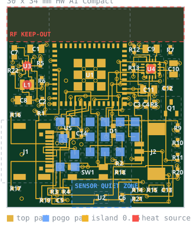
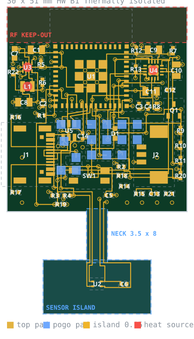

# 40 — Floorplans A and B

Both boards are emitted from one model (`tools/boardgen/`). The parts, values,
netlist, net classes and design rules are shared. `variants.py` defines the
outlines, sensor positions and thermal zones. Guarded routing and placement
modules also contain variant-specific geometry; they do not fork the electrical
platform. Every route change must be checked on both filled boards.

| |  |  |
|---|---|---|
| | **A — Compact**, HW A1 | **B — Thermally isolated**, HW B1 |

KiCad renders of the same two files: `img/render-a.png`, `img/render-b.png`.

## Side by side

| | **A — Compact** | **B — Thermally isolated** |
|---|---|---|
| PCB | 30 × 34 mm (1020 mm²) | 30 × 51 mm (1210 mm² incl. neck and island) |
| Layers | 4, FR-4, 1.6 mm | identical |
| Parts | 47 component footprints (46 fitted; R21 DNP) plus 17 test pads | identical |
| Sensor position | bottom edge, board centre | on a 18 × 9 mm island |
| Neck | — | 3.5 × 8.0 mm FR-4, 4 × 0.15 mm traces |
| Nearest heat source to the sensor | **11.5 mm** (D1) | **24.5 mm** (J1) |
| Idealized slab / neck conductance (not actual A/B coupling) | **70 mW/K** | **1.2 mW/K** |
| Hypothetical slab / neck ratio | — | **57×**, not a performance claim |
| Assembly difficulty | single-sided SMT; separate placement/stencil jobs | identical |
| Panel area / PCB cost | lower | ~19 % more area |
| Mechanical risk | rectangular PCB; retention still untested | the neck: 3.5 mm of FR-4 carrying an island |
| Enclosure | one chamber, vents at the sensor edge | two chambers with a dividing wall at the neck |

B now has the same 30 mm electronics-body width as A: the extra 2 mm of
right-side clearance accommodates the shared standby/wake/isolation controls
([ADR-001](adr/001-controlled-prototype-power-and-wake.md)). Electronics anchors
remain common; B's neck and island remain centered on its outline.

## What the layout actually decided

**The connectors moved to the side edges.** In B the bottom edge is where the
thermal neck leaves the board, and both variants share one placement table — so
the USB-C receptacle sits on the left edge and the PicoBlade pack header on the right in *both*.
This is a good example of the shared-model discipline paying off: a decision
forced by B automatically applies to A, and the two boards stay comparable.

**The antenna keep-out costs 170 mm².** Espressif ask for ~15 mm clear around
the module antenna. Neither board is 30 mm wider than the module, so in-plane we
give the antenna the **full width of the board for its whole length** and buy the
rest of the clearance from the enclosure. That is ~17 % of variant A's area
spent on a strip with no copper on any layer. It is also the only place on the
board with room for a silkscreen title block, which is where it now lives.

**There are no mounting holes.** M-04 forbids metal fasteners near the antenna;
a nylon M2 boss costs ~19 mm² on a board this size; and the printed enclosure can
register the board on ribs against the USB-C and pack-header cut-outs. Revisit at Rev 2
if that retention proves unreliable.

**Reference designators are not on the silkscreen.** Forty 0402s on 30 × 34 mm
cannot be silk-labelled legibly — KiCad's silk DRC said so, 93 times. The
assembly drawing (`F.Fab`/`B.Fab`, exported to `hardware/outputs/*/assembly/`)
carries every reference. The silkscreen carries what a human needs while holding
the board: name, revision, battery polarity, USB and pogo labels.

## Thermal interpretation

`45-thermal-model.md` compares a hypothetical solid slab with B's thin neck.
The slab has a **112×** copper/FR-4 conductance ratio, but A's actual sensor
quiet zone removes pours on every layer. Neither this ratio nor 57× describes
the actual comparison. The experiment must remain capable of choosing A.

## Why B is not obviously right either

1. **The neck is 3.5 mm of FR-4 holding an island.** Bare-board handling, depanel
   and assembly all apply force there. First bare-PCB inspection has to check it
   (open item EDS-8: 3.0 / 3.5 / 5.0 mm).
2. **Both variants depend on their enclosure.** Chamber walls, ribs, vents and
   battery placement create heat paths omitted by the slab calculation.
3. **19 % more board area, a longer enclosure, and a shape that is harder to
   panelise.** Real money at 20 units, and more at 200.
4. The four island traces are the entire electrical path to the sensor and they
   are 0.15 mm wide with no redundancy. An I²C bus that flakes there is a scrap
   board, not a rework.

## Routing status — stated plainly

Both boards are **partially routed**: the accepted 2026-11-12 checkpoint has
**25** unconnected items on A and **19** on B, checked with KiCad 10.0.6. The
[current plan](../plan.md) records the per-net backlog, and the development
budget enforces both the exact total and per-net counts. GND and USB-data
connections are complete at this checkpoint; fabrication requires zero opens
on every net. Earlier counts below are dated design history.
What the generator routes, and why:

| | |
|---|---|
| **Sensor island** — 4 nets | They carry a *rule* (0.15 mm, no vias, nothing else near them) that is also written into each `.kicad_dru`, so DRC enforces it against whoever routes the rest. |
| **Power fan-out** | Stubs to In2 plane vias where the router finds clearance; several pads remain unconnected. |
| **GND** | F.Cu/B.Cu pours and stitching; orphan fragments are removed. An unconnected pad still requires a deliberate return connection. |
| **Whatever else it could reach** | Track/via counts are printed by `make gen`; KiCad connectivity is the completion criterion. |

Remaining work includes charger controls, remote power trunks and MCU/fixture
branches. The USB data pair now has guarded dedicated routes, tested by actual
KiCad controls; its physical impedance/return acceptance remains EDS-19.
`hardware/drc-budget.json` records each variant's total, per-net counts and
warning identities. Manual routing is permitted by the working agreement;
reviewed fixed paths currently live in the generator so regeneration retains
them on both variants.

**Why the router stops there.** It has no rip-up and no shoving: once a net is
placed it stays, so a net routed early can permanently block one routed later.
That is a deliberate trade. A better autorouter exists — freerouting, via
Specctra DSN — but its output is a one-off artifact, and this repository's
central claim is that a rule change regenerates *both* boards identically. Route
by hand or by freerouting once, and the next time the neck width moves, someone
has to do it again and hope they make the same decisions twice.

Fresh filled-board KiCad reports for this checkpoint have **zero errors, zero
warnings and zero schematic parity differences** on both variants. These checks
do not complete the remaining routes or qualify the physical instrument.

The cleanup checkpoint enforces Power-class width rules after the general
fabrication minimum, uses bounded tagged pad-escape corridors, and takes the
larger interacting net-class clearance for obstacles. Failed construction
branches and unused signal vias are pruned without removing connected trunks
or the immutable sensor paths. USB maze routing is disabled; dedicated guarded pair routing
supplies the connector and ESD paths. Switch-node routes stay on the top layer. Routing remains open.

## Prior expectation, to be falsified

75 % on B. The number is a prior, not a result. `50-thermal-ab-test-plan.md`
is how we find out, and it is designed to be able to say "A is good enough" —
which, for a room-comfort sensor that spends 99.9 % of its life asleep and cold,
is a real possible answer.

## Copper geometry correction — 2026-10-12

Routing obstacles use each pad's local rotation before the footprint placement
rotation, including the module's bottom-edge pads. Pad copper, pin numbers and
placement rotations are unchanged by this parser correction.

Generated pours now always remove unconnected copper islands. The former
`island_removal_mode 1` meant **never**, not always; KiCad defines
[ALWAYS=0, NEVER=1, AREA=2](https://docs.kicad.org/doxygen/zone__settings_8h.html).
This removes orphan fill rather than waiving its DRC warnings. It does not join
an unconnected ground pad to the reference plane; missing connections still
need routing, and filled-board DRC is the acceptance check for both variants.

Track identifiers include layer, both endpoints and width. Branches leaving the
same point, or tracks starting at the same via on opposite layers, must not
share a UUID. A regression protects distinct identities and stable regeneration.
PCB output also strips trailing whitespace inherited from vendored footprint
indentation, so regenerated diffs pass the repository whitespace check.

The U1/U2 embedded library keepouts move to board-level rule areas to remove
KiCad library-comparison warnings without waiving them. The whole-board RF
keepout retains the antenna exclusion on all four copper layers. U2's exact
no-under-package F.Cu polygon retains its pad-slot openings and prohibits
tracks, vias and pours through the package body. Actual KiCad negative controls
check both antenna and sensor-body via exclusions after this move.

## USB connector orientation correction — 2026-10-14

HRO's drawing locates the PCB edge 5.79 mm forward of the NPTH datum;
the local footprint NPTH row is y=−2.60 mm. Both boards therefore put J1
at x=3.19 mm, y=24.5 mm and 270° rotation. Its mouth faces the left
case opening and overhangs the PCB by 0.46 mm. The original 90° orientation
faced into the board. Only the correctly oriented connector's front courtyard
may extend beyond the outline; copper and hole clearances retain their limits.
A regression test rejects the original orientation even though its courtyard
fitted inside the PCB. The source drawing and remaining assembly review are
recorded in [docs 63](63-assembly-qualification.md).

The USB data nets are `USB_D_P` and `USB_D_N`: KiCad requires complementary
P/N or +/− suffixes to recognize a differential pair. The earlier P/M naming
could leave pair constraints inactive. An actual KiCad negative control now
rejects an uncoupled pair; this is separate from completing and reviewing the
board routes.

## Shared local power placement review, 2026-10-21

The same explicit electronics placement is used in A and B. U3/L1 remain at
(3.4,10.0)/(3.4,13.2) mm and rotate to 270°/180° so SW points toward the
inductor. Local reservations are C1(4.9,7.1,180°), C7(1.25,7.7,270°),
C8(2.8,15.8,180°), C9(24.4,7.1,180°), C10(28.2,10.5,90°),
C11(24.0,14.0,0°), Q1(27.8,17.1,90°). These are geometry decisions, not
datasheet dimensions. C1 remains at U1's pin3 supply entrance; C7/C8 have
explicit regulator loops, while C10/C11 move from approximately y31 mm to
U4's neighborhood. Other passives repack around these reservations. The
routing function validates against its reviewed placement snapshot so later
anchor movement cannot silently leave fixed routes on old pad positions.

U1 centre-ground vias occupy the four gaps between the primary nine-pad
array. U4 uses four under-EP ground vias and a direct VSS/EP link; these
require the explicit assembler process acceptance in EDS-17. Neither thermal
sensor region nor B's four-trace neck receives a via. USB silk placement
searches the complete board body instead of silently falling back onto a
crowded connector-side area. Actual A/B DRC and enclosure proof accompany
source integration; airwire counts from earlier checkpoints remain historical.

### Charger local power paths, 2026-10-22

Both boards now explicitly route U4 IN13 to C9.1, OUT10/11 to C10.1, and
BAT2/3 to C11.1. Five same-face 0.8 mm ×0.15 mm pad escapes join 0.4 mm trunks
without adding vias or changing placement, footprint, schematic, BOM, stackup
or clearance. This removes speculative grid/via escape choices for the
already-routed IC power pads. The full isolated-board verification reported
A47/B45 unconnected items with zero DRC errors, warnings and parity differences;
these are a development checkpoint, and fabrication still requires zero
unconnected items. Remote power branches and charger control nets remain open.

### Variant B charger thermistor branch, 2026-11-11

A guarded U4.1 escape now reaches J2.2 through two paste-clear vias and a
B.Cu trunk on variant B. The generated board and filled-board KiCad report show
25 unconnected items on B, down from 26; A remains at 30. Both reports have
zero errors, warnings, parity differences, GND airwires, and USB data airwires.
R21.1 remains disconnected from this branch. Variant A's existing CHG_N trunk
occupies the proposed U4 escape via site, so this geometry does not apply to A.

### Variant A charger enable branch, 2026-11-11

The compact board now routes Q1.3 to R18.1 on CHARGE_EN_N around the Q1/LED
region, using two paste-clear vias. U4.4 remains open and needs a separately
reviewed fine-pitch escape. The filled-board report has 29 unconnected items
on A, down from 30, with zero errors, warnings, or parity differences.
Variant B's Q1.3-to-R18.1 route remains blocked by its current copper geometry.

The compact board also routes Q1.1 to its gate pull-down R7.1 on CHARGE_ENABLE with two
paste-clear vias and a B.Cu run beside the ILIM trunk. U1.24 remains open on
this net. The filled-board unconnected count on A is now 28; B remains 25.

### Charger status branches, 2026-11-11

A now joins R10.2 to U4.9 on CHG_N with an edge-side B.Cu run; TP14.1 is
still open. B now joins TP14.1 to R10.2 using one paste-clear via; U4.9 is
still open. These routes use different geometry because the generic autorouter
left different connected groups in each variant. Filled-board KiCad reports
show A27/B24 unconnected items, zero errors/warnings/parity differences, and
zero GND or USB-data airwires.

### Regulator controls, 2026-10-22

The shared U3 EN_REG/VSET pad escapes and R5/R6 connections now route through
standard vias and short B.Cu paths, with literal placement guards. Component
positions and enclosure geometry are unchanged. Via holes avoid solder-paste
lands, the VSET path avoids the regulator ground stitch, and the analog
parasitic/startup qualification in EDS-18 remains open.

### Local charger programming layout — 2026-10-22

C9 rotates 180° at its unchanged centre/courtyard; its nonpolar VBUS/GND
pads and actual routes move together. R12 (21.55, 7.2, 90°) and R13
(21.45, 10.3, 270°) now sit beside U4 instead of near the sensor end.
Both boards share these reservations before automatic small-signal placement.
This removes long programming loops without changing the common netlist or
values. At this historical pre-USB checkpoint B's nearest modeled heat source
was D1 at24.3 mm. The USB update below supersedes this placement distance.

## USB and fixture placement update

The shared A/B USB topology moves U5 to (10.3,20.5,90°), D1 to (18,21,90°)
and C14 to (12.6,21.4,270°). Six targets have explicit locations; the remaining
targets retain their original placement model. All targets retain standard
1.5 mm round copper pads. Use the generated [complete fixture map](41-fixture-map.md)
for board registration and underside mirroring. The full set is not a regular
2.54 mm array. The generator's candidate heat-source screen now reports D1 at
11.5 mm on A and J1 at24.5 mm on B; these centre distances do not establish
actual heating or A/B performance. USB return-path and impedance acceptance
remains EDS-19.

### GPIO8 pull-up plane access — 2026-11-11

R22 moves from the automatically packed (1.0,10.75,90°) position to the common
(1.0,12.4,90°) position on both boards. Its GPIO8/BOOT_MODE_H pin assignment,
10 kΩ value, package and rotation do not change. The former +3V0 pad was boxed
in by the EN_REG/VSET return corridor, neighbouring ground and the board edge.
The new +3V0 pad at (1.0,11.89) reaches an off-paste 0.6/0.3 mm via at
(0.8,11.2) through a 0.15 mm, 0.89 mm-long plane-neckdown stub. The existing
2.5 mm bounded plane-feed rule and normal clearances remain active. The
BOOT_MODE_H signal still needs its remote route; this closes only supply-plane
access. Placement/net guards and actual filled-board checks apply to A and B.

### Existing-via obstacle sizes — 2026-11-11

The maze router now blocks each existing via's actual copper diameter instead
of assuming the global default. This prevents under-clearance around a larger
via and unnecessary blockage around a smaller one. Current committed vias
retain their selected dimensions; the rejected density experiment is not
adopted. Mixed-size obstacle controls cover both cases and both routing layers.

### Fixed-copper reservation and connected routing — 2026-11-11

Reviewed charger-control, sense-divider and plane-access paths are reserved
before the plane escapes and maze routing. The maze identifies terminals joined
by physically touching fixed copper and does not route them again as separate
targets; circle and rounded-rectangle pad corners use their actual copper
shapes, so disconnected fixed islands remain separate. The guarded B PACK_TS
branch also offers its actual trace and through-via grid nodes as routing
sources. Fixed paths are preserved during dead-branch pruning. A connector-side
GND via at (23.0,21.0) on B joins a separated F.Cu return window to In1.Cu;
the generator checks its edge, protected-area and paste clearances. Both
variants retain identical electrical design and component placement. The
filled-board reports show A25/B19 unconnected items, zero other DRC findings,
zero parity differences, and no GND or USB-data airwires. The remaining opens
still prevent manufacturing release.

At this development checkpoint B closes one VBAT, one CHG_N and one PACK_TS
open, including the formerly disconnected R21.1 raw-TS pad. R21 remains DNP;
this does not connect raw TS to the MCU or authorize charging. Its incomplete UART connection moves from TX to RX; both debug directions
still require complete routing before fabrication. The exact counts and pad
endpoints remain in the filled reports; no existing release is requalified.

### Additive reset fixture branch candidate — 2026-11-12

An isolated candidate based on `7d631c6` closes one EN connection on each
board after generic routing/pruning, without moving any part or removing
retained copper. The occupancy-aware search starts on physically connected
copper components and respects the existing track/pad/via masks; it does not
blindly append a fixed path through occupied copper. All four EN endpoints
have explicit net/placement guards, and emitted vias are checked against paste.

Fresh filled candidate reports have A24/B18 unconnected items, zero
violations/warnings/parity and zero GND/USB-data airwires. EN alone falls from
two opens to one on each board; every other net count is unchanged. On A the
new branch joins the existing reset network to TP6, while C4 remains open. On
B it joins C4 to TP6, while the remote MCU/pull-up branch remains open. The
long A path is an unfinished-layout consequence, not measured reset immunity.
An actual KiCad deletion control removes a required EN via on each variant
and restores its second EN airwire. Root integration must recheck this search
against any concurrent supply/charger changes; this candidate does not close
manufacturing or bench qualification.

### Guarded VBAT inner-layer bridges — 2026-11-12

Main-board 0.4 mm In2.Cu bridges join the reviewed U4/C11 F.Cu trunk to the
existing VBAT fixture via and R14 divider input on both variants. In1.Cu GND
and all existing outer routes remain intact. New off-paste 0.6/0.3 mm vias land
at (22.2,13.2) and A(21.5,30.4)/B(19.0,28.8); the existing fixture via at
(19.2,20.0) is reused. Source/endpoint/net guards reject changed trunk or via
geometry. No stackup, component, electrical net or clearance rule changes.

The root-combined path detours left through (21.8,15.8) to avoid the newly
routed EN vias. Fresh generated/filled checks give A22/B16: VBAT2→0 on each,
all other per-net counts unchanged from the A24/B18 EN checkpoint. ERC/DRC
errors/warnings/parity and GND/USB opens remain zero; the +3V0 plane retains its
prior connectivity. Three host/actual-KiCad tests pass, including deletion of
either new landing via restoring a VBAT airwire. Evidence:
`/tmp/sensorly-routing-root-vbat2-{a,b}-20261112.json` and
`/tmp/sensorly-routing-root-vbat-tests-20261112.log`. This source proof does not
qualify rail transients, current/thermal behavior or supplier stackup/process.

### Shared system-supply inner bridge — 2026-11-12

A guarded 0.4 mm In2.Cu path joins the existing C10/U4 VSYS output trunk to the
C7/U3 input trunk. Its shared upper-body waypoints avoid the through-via field,
antenna exclusion and guarded USB reference. C10 uses an off-paste via at
(29.2,10.5) with a full-width F.Cu stub; the C7 landing at (2.0,6.9) reuses B's
existing via and adds the same 0.6/0.3 mm via on A. Guards retain the actual
terminal positions/nets, physical trunk landings and any existing input via.
In1.Cu GND, outer routes, stackup and electrical values remain unchanged.

Fresh combined root reports improve A22/B16 to A21/B15: VSYS3→2 on A and
1→0 on B, every other per-net count unchanged. Zero ERC/DRC errors/warnings,
parity differences and GND/USB opens remain. Six focused host/actual KiCad
controls pass; removing the C10 landing via restores exactly one VSYS open
on each board. Input/rail current and transient qualification remains open.
Evidence: `/tmp/sensorly-routing-root-vsys-{a,b}-20261112.json`,
`/tmp/sensorly-routing-root-vsys-tests-20261112.log` and
`/tmp/sensorly-routing-root-vsys-output-control-20261112.log`.

### Compact system-supply completion — 2026-11-13

A now joins its R5 input-bias terminal and TP3 fixture target to the common
VSYS network with guarded 0.4 mm inner trunks. R5 uses a short F.Cu stub to
(6.5,10.0); TP3 uses a B.Cu stub to (14.5,20.5), whose through drill lies
outside the 1.5 mm pogo target copper. Both use standard off-paste 0.6/0.3 mm
vias. The paths preserve the USB In2 reference and In1 GND. B already joins
these branches, so its generated board is unchanged.

Fresh root generation and both filled reports show A19/B15, only VSYS2→0 on
A versus the preceding checkpoint. VBAT/VSYS are now complete on both boards;
every other per-net count is unchanged. Errors, warnings, parity differences
and GND/USB opens remain zero. Five source guards and three actual KiCad
controls pass, including individual via deletion restoring one VSYS open.
Evidence: `/tmp/sensorly-routing-root-vsys-complete-{a,b}-20261113.json`,
`/tmp/sensorly-vsys-complete-{guards,kicad}-20261113.log`. Initial trial landings
crossed BTN_PROV or approached SCL too closely and were rejected; the accepted
landing/path is checked against retained copper. Rail and fixture qualification
remain open.
