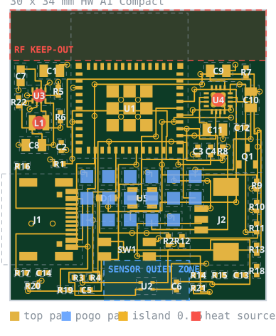
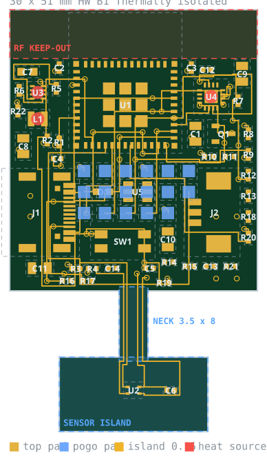

# 40 — Floorplans A and B

Both boards are emitted from one model (`tools/boardgen/`). The parts, values,
netlist, net classes and design rules are identical; `variants.py` is the only
file that differs between them, and it contains outline, sensor position and
thermal zones — nothing electrical.

| |  |  |
|---|---|---|
| | **A — Compact**, HW A1 | **B — Thermally isolated**, HW B1 |

KiCad renders of the same two files: `img/render-a.png`, `img/render-b.png`.

## Side by side

| | **A — Compact** | **B — Thermally isolated** |
|---|---|---|
| PCB | 30 × 34 mm (1020 mm²) | 30 × 51 mm (1210 mm² incl. neck and island) |
| Layers | 4, FR-4, 1.6 mm | identical |
| Parts | 47 component footprints (46 fitted; R21 DNP) plus 17 test pads | identical |
| Sensor position | bottom edge, board centre | on a 18 × 9 mm island |
| Neck | — | 3.5 × 8.0 mm FR-4, 4 × 0.15 mm traces |
| Nearest heat source to the sensor | **11.3 mm** (D1) | **22.7 mm** (R13) |
| Idealized slab / neck conductance (not actual A/B coupling) | **70 mW/K** | **1.2 mW/K** |
| Hypothetical slab / neck ratio | — | **57×**, not a performance claim |
| Assembly difficulty | single-sided SMT; separate placement/stencil jobs | identical |
| Panel area / PCB cost | lower | ~19 % more area |
| Mechanical risk | none | the neck: 3.5 mm of FR-4 carrying an island |
| Enclosure | one chamber, vents at the sensor edge | two chambers with a dividing wall at the neck |

B now has the same 30 mm electronics-body width as A: the extra 2 mm of
right-side clearance accommodates the shared standby/wake/isolation controls
([ADR-001](adr/001-controlled-prototype-power-and-wake.md)). Electronics anchors
remain common; B's neck and island remain centered on its outline.

## What the layout actually decided

**The connectors moved to the side edges.** In B the bottom edge is where the
thermal neck leaves the board, and both variants share one placement table — so
the USB-C receptacle sits on the left edge and the PicoBlade pack header on the right in *both*.
This is a good example of the shared-model discipline paying off: a decision
forced by B automatically applies to A, and the two boards stay comparable.

**The antenna keep-out costs 170 mm².** Espressif ask for ~15 mm clear around
the module antenna. Neither board is 30 mm wider than the module, so in-plane we
give the antenna the **full width of the board for its whole length** and buy the
rest of the clearance from the enclosure. That is ~17 % of variant A's area
spent on a strip with no copper on any layer. It is also the only place on the
board with room for a silkscreen title block, which is where it now lives.

**There are no mounting holes.** M-04 forbids metal fasteners near the antenna;
a nylon M2 boss costs ~19 mm² on a board this size; and the printed enclosure can
register the board on ribs against the USB-C and pack-header cut-outs. Revisit at Rev 2
if that retention proves unreliable.

**Reference designators are not on the silkscreen.** Forty 0402s on 30 × 34 mm
cannot be silk-labelled legibly — KiCad's silk DRC said so, 93 times. The
assembly drawing (`F.Fab`/`B.Fab`, exported to `hardware/outputs/*/assembly/`)
carries every reference. The silkscreen carries what a human needs while holding
the board: name, revision, battery polarity, USB and pogo labels.

## Thermal interpretation

`45-thermal-model.md` compares a hypothetical solid slab with B's thin neck.
The slab has a **112×** copper/FR-4 conductance ratio, but A's actual sensor
quiet zone removes pours on every layer. Neither this ratio nor 57× describes
the actual comparison. The experiment must remain capable of choosing A.

## Why B is not obviously right either

1. **The neck is 3.5 mm of FR-4 holding an island.** Bare-board handling, depanel
   and assembly all apply force there. First bare-PCB inspection has to check it
   (open item EDS-8: 3.0 / 3.5 / 5.0 mm).
2. **Both variants depend on their enclosure.** Chamber walls, ribs, vents and
   battery placement create heat paths omitted by the slab calculation.
3. **19 % more board area, a longer enclosure, and a shape that is harder to
   panelise.** Real money at 20 units, and more at 200.
4. The four island traces are the entire electrical path to the sensor and they
   are 0.15 mm wide with no redundancy. An I²C bus that flakes there is a scrap
   board, not a rework.

## Routing status — stated plainly

Both boards are **partially routed**: the 2026-10-14 regenerated checkpoint has
**59** unconnected items on A and **52** on B, checked with KiCad 10.0.6. The
development budget records these exact counts; fabrication requires zero.
What the generator routes, and why:

| | |
|---|---|
| **Sensor island** — 4 nets | They carry a *rule* (0.15 mm, no vias, nothing else near them) that is also written into each `.kicad_dru`, so DRC enforces it against whoever routes the rest. |
| **Power fan-out** | Stubs to In2 plane vias where the router finds clearance; several pads remain unconnected. |
| **GND** | F.Cu/B.Cu pours and stitching; orphan fragments are removed. An unconnected pad still requires a deliberate return connection. |
| **Whatever else it could reach** | Track/via counts are printed by `make gen`; KiCad connectivity is the completion criterion. |

The rest — mostly escapes from the 0.5 mm-pitch charger and the
USB-C receptacle's interleaved D+/D− pairs — is a KiCad session.
`hardware/drc-budget.json` records each variant's count and warning identities.

**Why the router stops there.** It has no rip-up and no shoving: once a net is
placed it stays, so a net routed early can permanently block one routed later.
That is a deliberate trade. A better autorouter exists — freerouting, via
Specctra DSN — but its output is a one-off artifact, and this repository's
central claim is that a rule change regenerates *both* boards identically. Route
by hand or by freerouting once, and the next time the neck width moves, someone
has to do it again and hope they make the same decisions twice.

Fresh filled-board KiCad reports for this checkpoint have **zero errors, zero
warnings and zero schematic parity differences** on both variants. These checks
do not complete the remaining routes or qualify the physical instrument.

The cleanup checkpoint enforces Power-class width rules after the general
fabrication minimum, uses bounded tagged pad-escape corridors, and takes the
larger interacting net-class clearance for obstacles. Failed construction
branches and unused signal vias are pruned without removing connected trunks
or the immutable sensor paths. USB maze routing is disabled pending a dedicated
coupled route. Switch-node routes stay on the top layer. Routing remains open.

## Prior expectation, to be falsified

75 % on B. The number is a prior, not a result. `50-thermal-ab-test-plan.md`
is how we find out, and it is designed to be able to say "A is good enough" —
which, for a room-comfort sensor that spends 99.9 % of its life asleep and cold,
is a real possible answer.

## Copper geometry correction — 2026-10-12

Routing obstacles use each pad's local rotation before the footprint placement
rotation, including the module's bottom-edge pads. Pad copper, pin numbers and
placement rotations are unchanged by this parser correction.

Generated pours now always remove unconnected copper islands. The former
`island_removal_mode 1` meant **never**, not always; KiCad defines
[ALWAYS=0, NEVER=1, AREA=2](https://docs.kicad.org/doxygen/zone__settings_8h.html).
This removes orphan fill rather than waiving its DRC warnings. It does not join
an unconnected ground pad to the reference plane; missing connections still
need routing, and filled-board DRC is the acceptance check for both variants.

Track identifiers include layer, both endpoints and width. Branches leaving the
same point, or tracks starting at the same via on opposite layers, must not
share a UUID. A regression protects distinct identities and stable regeneration.
PCB output also strips trailing whitespace inherited from vendored footprint
indentation, so regenerated diffs pass the repository whitespace check.

The U1/U2 embedded library keepouts move to board-level rule areas to remove
KiCad library-comparison warnings without waiving them. The whole-board RF
keepout retains the antenna exclusion on all four copper layers. U2's exact
no-under-package F.Cu polygon retains its pad-slot openings and prohibits
tracks, vias and pours through the package body. Actual KiCad negative controls
check both antenna and sensor-body via exclusions after this move.

## USB connector orientation correction — 2026-10-14

HRO's drawing locates the PCB edge 5.79 mm forward of the NPTH datum;
the local footprint NPTH row is y=−2.60 mm. Both boards therefore put J1
at x=3.19 mm, y=24.5 mm and 270° rotation. Its mouth faces the left
case opening and overhangs the PCB by 0.46 mm. The original 90° orientation
faced into the board. Only the correctly oriented connector's front courtyard
may extend beyond the outline; copper and hole clearances retain their limits.
A regression test rejects the original orientation even though its courtyard
fitted inside the PCB. The source drawing and remaining assembly review are
recorded in [docs 63](63-assembly-qualification.md).

The USB data nets are `USB_D_P` and `USB_D_N`: KiCad requires complementary
P/N or +/− suffixes to recognize a differential pair. The earlier P/M naming
could leave pair constraints inactive. An actual KiCad negative control now
rejects an uncoupled pair; this is separate from completing and reviewing the
board routes.

## Shared local power placement review, 2026-10-21

The same explicit electronics placement is used in A and B. U3/L1 remain at
(3.4,10.0)/(3.4,13.2) mm and rotate to 270°/180° so SW points toward the
inductor. Local reservations are C1(4.9,7.1,180°), C7(1.25,7.7,270°),
C8(2.8,15.8,180°), C9(24.4,7.1,0°), C10(28.2,10.5,90°),
C11(24.0,14.0,0°), Q1(27.8,17.1,90°). These are geometry decisions, not
datasheet dimensions. C1 remains at U1's pin3 supply entrance; C7/C8 have
explicit regulator loops, while C10/C11 move from approximately y31 mm to
U4's neighborhood. Other passives repack around these reservations. The
routing function validates against its reviewed placement snapshot so later
anchor movement cannot silently leave fixed routes on old pad positions.

U1 centre-ground vias occupy the four gaps between the primary nine-pad
array. U4 uses four under-EP ground vias and a direct VSS/EP link; these
require the explicit assembler process acceptance in EDS-17. Neither thermal
sensor region nor B's four-trace neck receives a via. USB silk placement
searches the complete board body instead of silently falling back onto a
crowded connector-side area. Actual A/B DRC and enclosure proof accompany
source integration; airwire counts from earlier checkpoints remain historical.

### Charger local power paths, 2026-10-22

Both boards now explicitly route U4 IN13 to C9.1, OUT10/11 to C10.1, and
BAT2/3 to C11.1. Five same-face 0.8 mm ×0.15 mm pad escapes join 0.4 mm trunks
without adding vias or changing placement, footprint, schematic, BOM, stackup
or clearance. This removes speculative grid/via escape choices for the
already-routed IC power pads. The full isolated-board verification reported
A47/B45 unconnected items with zero DRC errors, warnings and parity differences;
these are a development checkpoint, and fabrication still requires zero
unconnected items. Remote power branches and charger control nets remain open.
